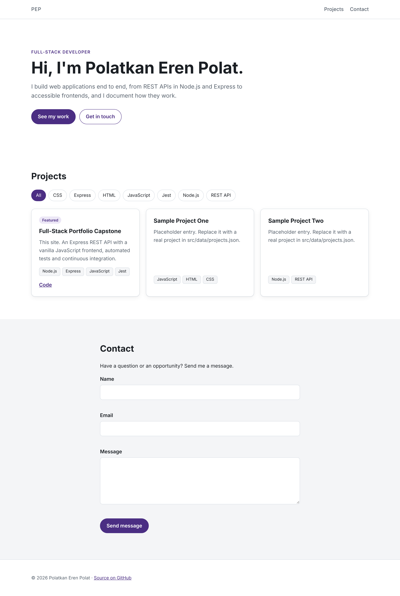
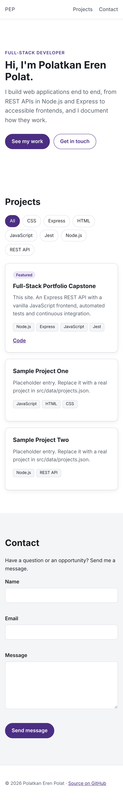
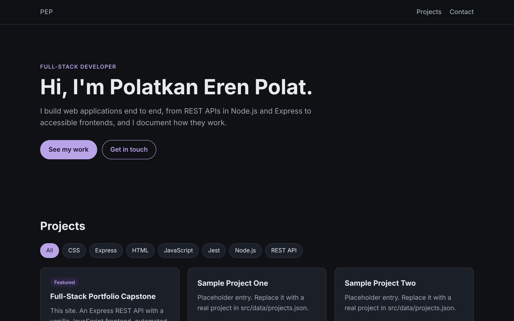
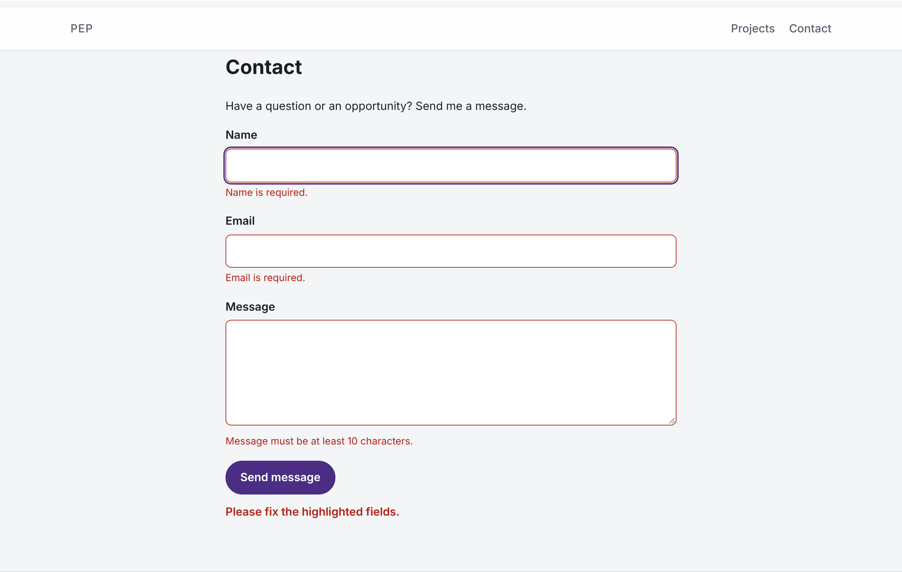

# Full-Stack Portfolio Capstone

[](https://github.com/polatkaneren/fullstack-portfolio-capstone/actions/workflows/ci.yml)

A personal portfolio website with a Node.js/Express REST API and a plain HTML, CSS and JavaScript frontend. Visitors can browse projects, filter them by technology, and send a message through a contact form.

It is also the capstone project for a technical documentation course: progress and metrics are tracked in [`docs/METRICS.md`](docs/METRICS.md).



## Features

- **Projects API.** `GET /api/projects` lists projects and can filter them by tag.
- **Contact API.** `POST /api/contact` validates messages and returns a clear error for each field.
- **Responsive frontend** with automatic dark mode and keyboard and screen-reader support.
- **Security basics:** security headers (Helmet), a CORS allow-list, a rate limit on the contact form, a spam honeypot and a request size limit.
- **Automated tests** (Jest + Supertest) that fail the build below 70% coverage.
- **Continuous integration.** GitHub Actions runs the tests on every push.

## Tech stack

| Layer | Technology |
|---|---|
| Runtime | Node.js 20+ |
| Backend | Express 5, Helmet, cors, express-rate-limit |
| Frontend | HTML, CSS, JavaScript (no framework, no build step) |
| Testing | Jest, Supertest |
| CI | GitHub Actions |

## Quick start

You need [Node.js](https://nodejs.org/) version 20 or newer. Check with `node -v`.

```bash
git clone https://github.com/polatkaneren/fullstack-portfolio-capstone.git
cd fullstack-portfolio-capstone
npm install
npm start
```

Open <http://localhost:3001> in your browser.

## Scripts

| Command | What it does |
|---|---|
| `npm start` | Starts the server |
| `npm run dev` | Starts the server and restarts it when a file changes |
| `npm test` | Runs the tests |
| `npm run test:coverage` | Runs the tests and prints a coverage report (fails below 70%) |

## Configuration

Settings come from environment variables. Copy `.env.example` to `.env` to change them locally. Never commit `.env`.

| Variable | Default | Purpose |
|---|---|---|
| `PORT` | `3001` | Port the server listens on |
| `NODE_ENV` | `development` | `production` when deployed |
| `CORS_ORIGIN` | *(empty)* | Comma-separated origins allowed to call the API from another domain. Leave it empty when this server also serves the frontend. |

## API reference

All responses are JSON.

### `GET /api/projects`

Returns every project. Add `?tag=Express` to get only projects with that tag (case-insensitive).

```json
{
  "count": 1,
  "data": [
    {
      "id": "fullstack-portfolio-capstone",
      "title": "Full-Stack Portfolio Capstone",
      "summary": "This site...",
      "tags": ["Node.js", "Express", "JavaScript", "Jest"],
      "repoUrl": "https://github.com/polatkaneren/fullstack-portfolio-capstone",
      "liveUrl": null,
      "featured": true
    }
  ]
}
```

### `GET /api/projects/:id`

Returns one project as `{ "data": { ... } }`, or `404` if no project has that id.

### `POST /api/contact`

Request body:

```json
{ "name": "Ada Lovelace", "email": "ada@example.com", "message": "Hello! I'd like to talk." }
```

| Status | Meaning | Body |
|---|---|---|
| `201` | Message received | `{ "message": "Thanks! ...", "id": "..." }` |
| `400` | Invalid input | `{ "error": "...", "fields": { "email": "Enter a valid email address." } }` |
| `413` | Body larger than 20 KB | `{ "error": "..." }` |
| `429` | More than 5 messages in 15 minutes from one address | `{ "error": "..." }` |

Rules: `name` is required (100 characters at most), `email` must be a valid address, and `message` must be 10 to 5,000 characters.

> **Note:** messages are kept in server memory and are lost when the server restarts. Connecting a database or an email service is planned (see [`src/contactStore.js`](src/contactStore.js)).

### `GET /api/health`

Returns `{ "status": "ok" }`. Hosting platforms use it to check that the server is running.

## Project structure

```
├── public/                 Frontend served to the browser
│   ├── index.html
│   ├── styles.css
│   └── app.js              Loads projects and handles the contact form
├── src/                    Backend
│   ├── server.js           Starts the server
│   ├── app.js              Builds the Express app (middleware + routes)
│   ├── config.js           Reads environment variables
│   ├── routes/             One file per API resource
│   ├── middleware/         404 and error handling
│   ├── validation.js       Contact form rules
│   ├── contactStore.js     Where contact messages are saved
│   └── data/projects.json  The projects shown on the site
├── tests/                  Jest + Supertest tests
├── docs/                   Metrics log and screenshots
└── .github/workflows/      CI pipeline
```

## Editing your projects

Projects live in [`src/data/projects.json`](src/data/projects.json). Add, edit or remove entries there and restart the server. Each entry needs a unique `id`, a `title`, a `summary` and a list of `tags`. `repoUrl` and `liveUrl` can be `null`.

## Testing

```bash
npm run test:coverage
```

The tests start the app in memory, so no running server is needed. The build fails if statement, branch, function or line coverage drops below 70%.

## Screenshots

| Mobile | Dark mode | Form validation |
|---|---|---|
|  |  |  |

## License

[MIT](LICENSE)
