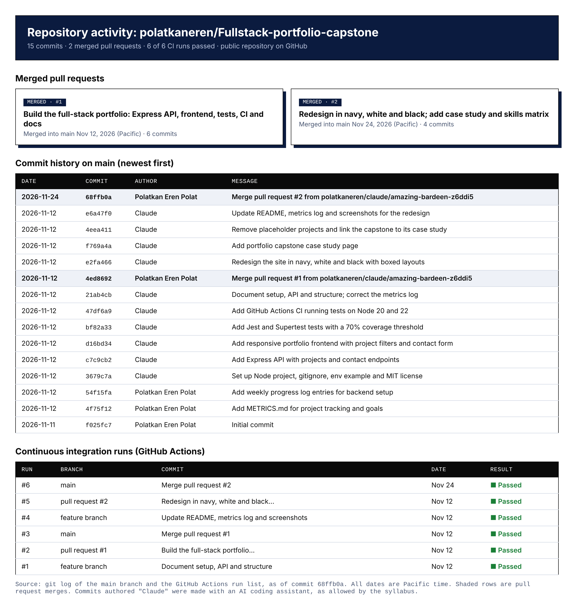
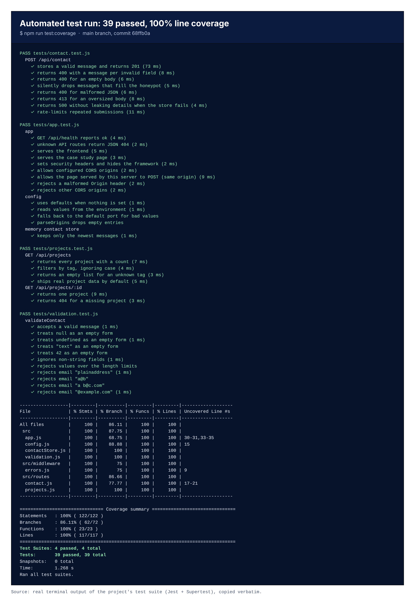
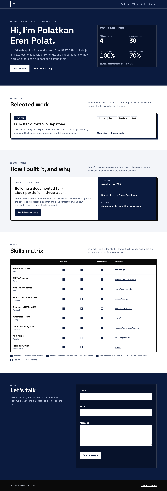
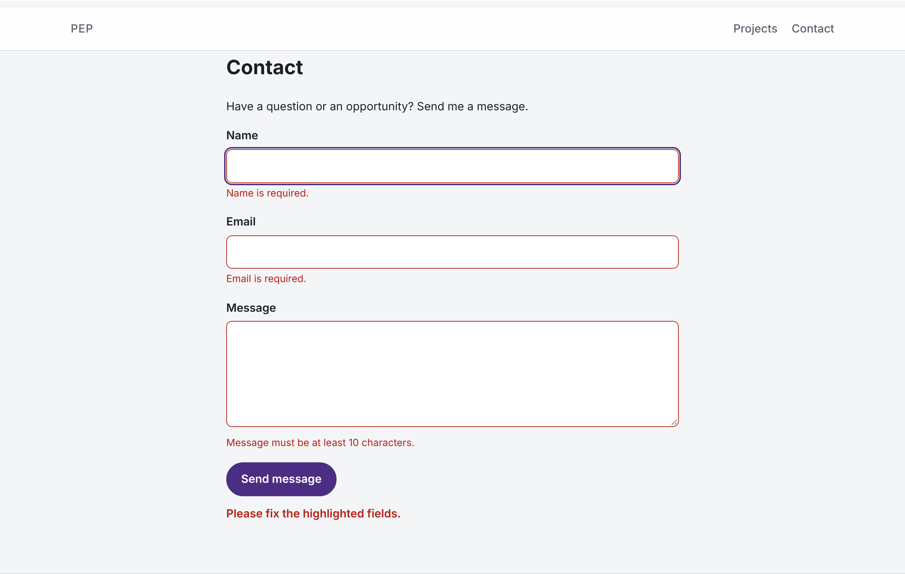

# Project Evidence

Evidence that the best practice for this capstone (structured Markdown documentation, GitHub version control and tracked metrics) was applied. All dates are Pacific time.

| What | Where to verify |
|---|---|
| Repository (public) | <https://github.com/polatkaneren/Fullstack-portfolio-capstone> |
| Commit history | <https://github.com/polatkaneren/Fullstack-portfolio-capstone/commits/main> |
| Pull request #1 (merged 11/12) | <https://github.com/polatkaneren/Fullstack-portfolio-capstone/pull/1> |
| Pull request #2 (merged 11/24) | <https://github.com/polatkaneren/Fullstack-portfolio-capstone/pull/2> |
| Continuous integration runs | <https://github.com/polatkaneren/Fullstack-portfolio-capstone/actions> |
| Metrics log | [`docs/METRICS.md`](METRICS.md) |
| Case study | [`public/case-studies/portfolio-capstone.html`](../public/case-studies/portfolio-capstone.html) |

## 1. Version control: commits, pull requests and CI

15 commits, 2 merged pull requests, and 6 of 6 automated CI runs passed.

## 2. Automated tests

39 tests pass with 100% line coverage, against a goal of 70%.

## 3. The working portfolio site

Home page with the featured project, case study, skills matrix and contact form:

Case study page, written as structured technical documentation:

The contact form validates input and explains each error:

## Note on tools

Commits authored "Claude" were made with an AI coding assistant (Claude Code), as allowed by the course syllabus.
